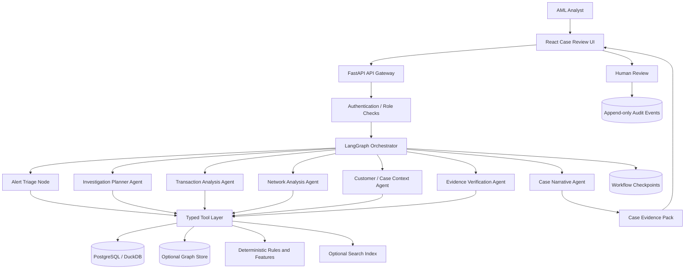

# Agentic Financial Crime Investigation System
## Detailed Project Plan, Architecture, Technology Stack, Data Strategy, Evaluation, and Implementation Roadmap

**Project type:** Industry-oriented solo engineering project  
**Domain:** Banking, fintech, Anti-Money Laundering (AML), financial-crime operations  
**Initial focus:** Alert triage and investigation support for suspicious transaction patterns  
**Deployment principle:** Local-first, open-weight models, synthetic/public data only  
**Target timeline:** 8–10 weeks at approximately 10–15 focused hours per week  
**Document status:** Proposed engineering blueprint; all performance targets are hypotheses to validate, not achieved results.

---

## 1. Executive Summary

Build an **Agentic Financial Crime Investigation System** that helps an AML analyst investigate suspicious transaction alerts by assembling transaction evidence, identifying suspicious behavioral patterns, mapping relationships between accounts, checking available customer and case context, validating competing hypotheses, and preparing a human-reviewable investigation report.

Conventional AML systems commonly generate alerts from rules or machine-learning models, while analysts must manually gather supporting context from multiple systems. This project focuses on the investigation stage: it orchestrates several bounded tools and specialist agents to turn an alert into an evidence-backed case summary.

The system will:

1. Receive an alert or a batch of synthetic alerts.
2. Prioritize the alert using transparent, deterministic features and a risk model if available.
3. Gather a bounded transaction window and relevant account/customer attributes.
4. Analyze transaction sequences, velocity, counterparties, and transaction-network structure.
5. Test supported typology hypotheses such as rapid movement of funds, structuring-like behavior, circular transfers, or many-to-one / one-to-many flows.
6. Retrieve historical alerts and prior analyst decisions where the synthetic dataset provides them.
7. Cross-check each key statement against structured records or source evidence.
8. Draft a case narrative, timeline, suspicious indicators, alternative explanations, missing information, and follow-up questions.
9. Route the case to a human analyst for disposition. No suspicious-activity report is automatically filed and no transaction is blocked by the prototype.

The project is designed to demonstrate genuine agentic behavior: stateful orchestration, conditional tool selection, query refinement, bounded retries, evidence verification, persisted workflow state, and escalation when evidence is insufficient. It must not treat the LLM's opinion as a verified fraud or money-laundering determination.

### Expected business value

- Reduce the manual time required to assemble the initial evidence pack.
- Improve consistency and completeness of analyst case notes.
- Make transaction relationships easier to inspect using graph views.
- Preserve traceability from every major claim to transaction IDs, timestamps, and deterministic features.
- Measure whether an agentic workflow improves case quality and investigator efficiency relative to a rules-only or conventional RAG baseline.

---

## 2. Business Problem and Project Objectives

### 2.1 Problem statement

Financial institutions may receive large volumes of transaction-monitoring alerts. An analyst must decide what happened, which entities are connected, whether activity deviates from expected behavior, what evidence supports the suspicion, what benign explanations remain plausible, and whether further escalation is warranted.

The proposed system does not replace transaction-monitoring controls or the accountable analyst. It focuses on investigation orchestration and evidence organization.

### 2.2 Target users

- AML transaction-monitoring analysts
- Fraud operations and financial-crime investigators
- AML team leads or quality reviewers
- Model-risk, audit, and compliance stakeholders evaluating investigation consistency

### 2.3 Primary objective

For each alert, produce an **auditable investigation pack** containing relevant records, graph and temporal evidence, candidate typologies, verified findings, uncertainties, and a draft narrative that a human reviewer can approve, edit, or reject.

### 2.4 Success criteria

A successful MVP must:

- Ingest synthetic transactions and known alert labels.
- Allow a user to open an alert and start an investigation.
- Use tools to retrieve transactions, customer metadata, and counterparty relationships.
- Execute at least two conditional branches based on evidence or investigation state.
- Recover from a retriable tool failure and escalate after bounded retries.
- Preserve execution state and resume an interrupted investigation.
- Link every material transaction claim to transaction IDs or source records.
- Produce a reviewable report and record the human decision.
- Be evaluated against non-agentic baselines using a held-out test set.

### 2.5 Non-goals for the MVP

- Autonomous filing of Suspicious Transaction Reports (STRs/SARs) or regulatory submissions.
- Automatic account freezes, payment declines, customer offboarding, or law-enforcement referrals.
- Live connection to a bank's core banking, payments, case-management, sanctions, or KYC production systems.
- Use of real customer personally identifiable information (PII) or production credentials.
- Making final legal, regulatory, or criminal determinations.
- A claim that all suspicious patterns can be detected or that an LLM can identify criminal intent.

---

## 3. Product Scope and User Journey

### 3.1 MVP features

1. **Alert inbox:** synthetic alert list with alert type, timestamp, triggered rule, severity, status, and model-generated priority recommendation.
2. **Investigation launch:** analyst selects an alert, a time window, and the approved data scope.
3. **Evidence collection:** transaction and account records are retrieved through deterministic tools.
4. **Pattern analysis:** deterministic features, temporal analysis, and graph analysis surface candidate indicators.
5. **Hypothesis testing:** the workflow tests selected typologies and can seek additional evidence if key data are missing.
6. **Case narrative:** local LLM generates a structured draft from verified facts and evidence references.
7. **Evidence explorer:** transaction timeline, account network, indicators, source IDs, and alternative explanations.
8. **Human review:** reviewer marks the case as close / continue investigation / escalate for further review, with a reason. Labels are demonstrative and must be configurable for the governing institution's procedures.
9. **Audit trail:** record tool calls, state transitions, source record IDs, model/version metadata, reviewer decisions, and export events.
10. **Evaluation console:** compare the agentic investigation workflow with deterministic and single-LLM baselines.

### 3.2 Example scenario

A synthetic alert identifies an account that receives transfers from several unrelated accounts, then transfers most of the total onward within a short period. The system should:

- Retrieve the triggering transactions and surrounding history.
- Calculate inflow/outflow ratios, time gaps, transaction counts, counterparty counts, and balance-flow summaries where fields permit.
- Build a bounded transaction subgraph and highlight multi-hop paths.
- Check whether similar alerts or linked accounts appear in the available history.
- Test whether the pattern is consistent with a known synthetic typology in the dataset.
- Search for counter-evidence or plausible benign explanations, such as payroll, merchant settlement, or known business flows if the dataset includes that context.
- Produce a concise evidence-backed case draft without claiming criminal intent as fact.
- Ask an analyst to review the evidence and decide what to do next.

### 3.3 MVP boundary

Use one synthetic dataset and a small catalog of typology rules at first. Broaden the typology library only after the end-to-end workflow, evidence provenance, and evaluation are working.

---

## 4. High-Level Architecture



### Architecture decisions

- **Modular monolith first:** keep one application with separated modules. The project is for one developer and does not need microservices initially.
- **LangGraph for orchestration:** represent work as a typed state graph with explicit routes, checkpoints, retries, and human-review pauses.
- **Deterministic financial calculations:** compute counts, sums, ratios, time differences, graph paths, and rule triggers using Python/SQL/graph algorithms—not generated arithmetic.
- **LLM for bounded interpretation:** use it for alert planning, tool selection among approved tools, hypothesis explanation, and narrative drafting.
- **Evidence-first outputs:** every important factual assertion should resolve to transaction IDs, feature records, or source passages.
- **Least privilege:** agents can only call narrowly scoped tools. They do not get arbitrary SQL, shell, or unrestricted file access.
- **Human accountability:** final disposition remains a human decision in this prototype.

---

## 5. Recommended Technology Stack

### 5.1 Core stack

| Layer | Recommended technology | Role | MVP priority |
|---|---|---|---|
| Language | Python 3.11+ (choose a version compatible with all libraries) | Services, analysis, orchestration | Required |
| API | FastAPI + Pydantic | Typed endpoints and validation | Required |
| Agent orchestration | LangGraph | Stateful workflow, conditional routes, retries, review pauses | Required |
| Local LLM runtime | Ollama for simple local setup; consider vLLM on capable GPU hardware | Serve open-weight LLMs locally | Required for LLM features |
| LLM candidates | Start by benchmarking a quantized Qwen3 4B-class instruct model; try an 8B-class candidate if resources permit | Structured reasoning and narrative drafting | Required, model replaceable |
| SQL storage | PostgreSQL | Alerts, transactions, accounts, cases, findings, reviews | Required |
| Analytics / local experiments | DuckDB + Parquet | Efficient offline dataset exploration and repeatable analysis | Recommended |
| Graph analysis | NetworkX for MVP; optional Neo4j Community for graph exploration | Multi-hop relationships, connected components, degree and path analysis | Required capability; database optional |
| Dataframe processing | pandas or Polars | Feature creation and evaluation | Required |
| Numerical ML | scikit-learn | Baseline anomaly/risk model and metrics | Recommended |
| Explainability | SHAP only if a compatible supervised model is added; otherwise explicit feature reasons | Explain model scores | Optional |
| Dashboard | React + TypeScript | Alert inbox and case review UI | Recommended |
| Graph visualization | Cytoscape.js or vis-network | Transaction network exploration | Recommended |
| Charts | Recharts or Plotly | Timeline and feature visualization | Optional |
| Workflow persistence | LangGraph checkpointer backed by a supported persistent store; PostgreSQL is a reasonable durable store | Resume and recover workflows | Required before calling it robust |
| Object storage | Local filesystem or MinIO | Original input files, report artifacts | Optional for synthetic CSVs; MinIO if documents are added |
| Tests | pytest, httpx | Unit and API tests | Required |
| Data quality | Pandera or Pydantic validation | Validate tabular inputs | Recommended |
| Packaging | Docker Compose | Reproducible local environment | Required for shareable demo |
| Logging | Python structured logging; OpenTelemetry optional | Request, tool, and workflow telemetry | Required at basic level |

### 5.2 Why this stack

- It supports local, low-cost development without a paid model API.
- The majority of computation is deterministic and inexpensive; the LLM is used only where it adds value.
- It allows a small local prototype to grow into asynchronous ingestion and separate services if needed.
- PostgreSQL is sufficient for authoritative case data. Use a graph database only if the network investigation use case benefits enough to justify operating it.

### 5.3 Model selection and hardware strategy

Start with a quantized 4B-class open-weight instruct model on a capable local machine. Test an 8B-class model only if available RAM/VRAM, latency, and quality permit. Model names and runtime behavior change; verify current model cards, licenses, supported context windows, structured-output behavior, and tool-calling reliability before final selection.

Use one model at first, with task-specific prompts and schemas. Separate models per agent can add resource and maintenance costs without guaranteeing better outcomes.

**Do not assume that a model's self-reported confidence is calibrated.** Confidence in reports should be based on measured model performance, explicit evidence completeness, and human validation—not a number invented by the LLM.

### 5.4 Optional technologies—add only when justified

- **Neo4j:** helpful for interactive graph traversal and analyst exploration. Confirm community/enterprise feature boundaries and licensing before choosing graph algorithms for any non-personal project.
- **Elasticsearch / OpenSearch:** unnecessary for the first transaction-only MVP; add if document-heavy evidence or high-volume searches justify it.
- **Kafka:** unnecessary for a solo, low-volume MVP. Add only when asynchronous ingestion or replayable event processing is a concrete requirement.
- **Redis:** optional for caching or job coordination; do not use it as the only persistent workflow store.
- **MLflow:** useful if several models and experiments must be tracked; optional for the initial baseline.

---

## 6. Data Strategy and Datasets

Use synthetic or explicitly permitted public datasets only. Public availability does not automatically mean unrestricted reuse; review the actual dataset license and terms before redistributing it.

### 6.1 Recommended primary dataset: IBM AMLSim

**Resource:** https://github.com/IBM/AMLSim/

AMLSim is a synthetic banking transaction simulator intended for generating transaction data with known money-laundering patterns. It is designed to help researchers evaluate machine-learning models and graph algorithms. It is a strong primary choice because known patterns can support controlled tests and investigation workflow evaluation. See the upstream repository for configuration, outputs, dependencies, and citation instructions.

**Important implementation note:** The upstream project has legacy dependencies and setup instructions. Check the current repository, pin a known working revision, isolate the simulator in its own environment/container, and convert its outputs to the project's canonical schema. Do not assume its old runtime dependencies are compatible with the main application.

### 6.2 Alternative / supplementary dataset: IBM AML-Data

**Resource:** https://github.com/IBM/AML-Data/

This is a synthetic financial transaction dataset with money-laundering labels. The repository notes that its code repository license differs from the dataset's license; the data is indicated as being under CDLA-Sharing-1.0. Review the dataset license and redistribution requirements separately from the code license. Do not bundle dataset files in a public repository unless the terms permit it.

### 6.3 Optional supplementary dataset: PaySim

PaySim is a synthetic mobile-money transaction dataset commonly used for transaction fraud detection. It is useful for a related fraud-alert workflow or general transaction anomaly experiments, but it is not a substitute for a money-laundering dataset with laundering typologies and ground truth. Check the original paper and the actual distribution platform's license/terms before use.

### 6.4 Recommended data plan

1. Use AMLSim as the main source for known transaction patterns and alert-to-case linking.
2. Create a small, clearly labeled synthetic customer/account metadata table if the simulator does not provide enough context for the desired UI.
3. Add supplementary public datasets only after the canonical data model and evaluation framework are stable.
4. Build a small handcrafted test suite for edge cases that the selected dataset does not cover.

### 6.5 Canonical data schema

Normalize the selected dataset into these logical tables. Map the real source columns carefully rather than assuming every dataset has every field.

#### `accounts`

- `account_id` (primary key)
- `customer_id` (nullable)
- `account_type` (nullable)
- `opened_at` (nullable timestamp)
- `country_code` (synthetic or dataset-supported; nullable)
- `risk_attributes` (JSON, optional, with provenance)

#### `transactions`

- `transaction_id` (primary key)
- `event_timestamp`
- `sender_account_id`
- `receiver_account_id`
- `amount`
- `currency`
- `transaction_type`
- `channel` (nullable)
- `transaction_status`
- `source_dataset`
- `source_record_id`
- `label` (nullable; synthetic ground-truth label, not analyst decision)

#### `alerts`

- `alert_id` (primary key)
- `account_id` or `entity_id`
- `triggered_at`
- `rule_code`
- `trigger_reason`
- `source_model_score` (nullable)
- `synthetic_ground_truth` (nullable and segregated from agent-visible data)
- `status`

#### `cases`

- `case_id` (primary key)
- `alert_id`
- `created_at`
- `created_by`
- `investigation_status`
- `assigned_reviewer` (nullable)
- `final_human_disposition` (nullable)
- `decision_reason` (nullable)

#### `findings`

- `finding_id` (primary key)
- `case_id`
- `finding_type`
- `summary`
- `evidence_refs` (structured references)
- `verification_status`
- `model_version`
- `created_at`

#### `audit_events`

- `event_id`
- `case_id`
- `actor_type` and `actor_id`
- `action`
- `timestamp`
- `tool_name` (nullable)
- `input_hash` / `output_hash` where suitable
- `outcome`
- `correlation_id`

Keep ground-truth labels in a separate evaluation namespace or access-controlled view. Never expose labels to the agents during blind evaluation, as this would invalidate results.

---

## 7. Financial-Crime Typology and Feature Library

Start with a small, explainable typology library. Typologies are risk indicators, not proof of wrongdoing. Thresholds should be documented, configurable, and calibrated against the synthetic dataset.

### 7.1 Initial patterns to support

1. **Rapid in-and-out movement:** substantial inbound funds are followed by outbound transfers within a short period.
2. **Many-to-one aggregation:** multiple distinct accounts send money to one account in a limited time window.
3. **One-to-many dispersion:** one account transfers to many distinct counterparties.
4. **Potential structuring-like pattern:** repeated transactions near configured thresholds or repeated amounts, only when suitable data and a defensible threshold exist. Do not infer illegal structuring from amounts alone.
5. **Circular transfers:** funds move through a bounded path and return to an originating account or entity.
6. **Unusual velocity:** transaction count or total value increases sharply relative to the account's available baseline.
7. **Dormant-to-active behavior:** an account with a long inactive period suddenly begins transacting, if history supports this feature.
8. **Shared-counterparty network:** apparently separate accounts repeatedly interact with a common set of accounts.
9. **Unusual time or geography:** only if timestamp, channel, and geography fields are reliable and policy-approved.

Avoid implementing every pattern at once. Begin with rapid movement, many-to-one/one-to-many flows, and basic network connectivity because these are easier to validate visually.

### 7.2 Deterministic transaction features

- Inbound/outbound transaction counts in 1-hour, 24-hour, and 7-day windows
- Inbound/outbound amounts and ratio
- Number of unique counterparties
- Median and maximum transaction amount
- Time from inbound to outbound transfer
- Percentage of recent inbound funds transferred out in a defined window
- Change from the account's baseline behavior
- Number of hops and cycles within a bounded transaction graph
- Counterparty overlap with linked alerts
- Data completeness indicators

Use exact currency-aware Decimal arithmetic for amounts where possible. Define timezone rules explicitly. Handle reversals, cancellations, duplicated records, and transactions with missing endpoints distinctly.

### 7.3 Baseline analytics

- Rule-based indicators with human-readable explanations
- Isolation Forest or another simple unsupervised baseline only if feature quality supports it
- Supervised classifier only if labels and train/test splits are defensible
- Graph-derived features such as degree, connected components, bounded paths, and neighborhood overlap

A machine-learning score may prioritize attention but must not be treated as a criminal determination. Report feature contributions only when they are actually calculated from the deployed model.

---

## 8. Agent Responsibilities and Tool Contracts

Use a central orchestrator and a small set of specialist nodes. Several nodes can be deterministic functions rather than free-form agents.

### 8.1 Orchestrator / Investigation Manager

**Responsibilities**
- Interpret the alert and requested investigation scope.
- Form a bounded plan and select permitted investigative steps.
- Route to transaction analysis, graph analysis, context lookup, or further evidence retrieval.
- Check whether required evidence is present before drafting a report.
- Control retries and escalation.
- Persist workflow state and pause for reviewer input.

**Outputs:** typed plan, next action, state transitions, unresolved questions.

### 8.2 Alert Triage Node

Prefer deterministic prioritization plus a short LLM explanation. Use known alert features, transaction size relative to baseline, graph signals, and data quality. Never let the LLM invent a numeric risk score; numeric scores must be produced by code or an evaluated model.

### 8.3 Investigation Planner Agent

Break the task into a finite set of investigative objectives. Example objectives: validate trigger, gather 30-day history, measure velocity, map top counterparties, test relevant typologies, search related alerts, and verify evidence.

### 8.4 Transaction Analysis Agent

Calls typed tools to obtain transactions and calculate deterministic temporal/velocity features. It explains computed results but does not perform unaudited arithmetic in free text.

### 8.5 Network Analysis Agent

Analyzes bounded transaction subgraphs and paths. Returns node/edge references, counts, path descriptions, and computed metrics. It must declare graph truncation or time-window limitations.

### 8.6 Customer / Case Context Agent

Retrieves only permitted synthetic profile fields, prior alerts, and prior case outcomes. It must distinguish missing data from negative evidence and must not infer personal traits or protected characteristics.

### 8.7 Typology Analyst Agent

Selects among a pre-defined set of supported typologies based on observed features. It returns a hypothesis with supporting evidence, counter-evidence, missing information, and confidence language constrained by measured performance. Unsupported typologies should be marked unavailable, not improvised as established fact.

### 8.8 Evidence Verification Node

A mix of deterministic validation and model-assisted review:
- Every referenced transaction ID exists and is in scope.
- Sums/counts match the computation service.
- Dates and amounts match the database.
- The claim is supported by the cited facts.
- Counter-evidence and data gaps are not omitted.
- No final criminal or legal conclusion is stated as established fact.

### 8.9 Case Narrative Agent

Drafts a concise structured narrative from verified data only. It must not gain access to hidden ground-truth labels during blind testing. It should use calibrated wording, such as “indicator consistent with the configured pattern,” instead of “the customer laundered money.”

### 8.10 Human reviewer

The human is an accountable decision maker, not another autonomous agent. Reviewers can approve the draft, request more evidence, change the narrative, mark false positive for evaluation, or escalate for additional investigation. Real institutional workflows may differ and should be configured by authorized compliance experts.

### 8.11 Approved tool inventory

Expose only narrow, typed functions such as:

- `get_alert(alert_id)`
- `get_account_summary(account_id, time_window)`
- `get_transactions(account_id, start_time, end_time, direction, limit)`
- `get_counterparties(account_id, time_window, limit)`
- `compute_velocity_features(account_id, time_window)`
- `detect_supported_patterns(account_id, time_window, pattern_ids)`
- `build_transaction_subgraph(account_ids, start_time, end_time, max_nodes, max_edges)`
- `find_bounded_paths(source_account_id, target_account_id, max_hops, time_window)`
- `get_related_alerts(account_ids, time_window, limit)`
- `validate_evidence_references(evidence_refs)`
- `save_draft_findings(case_id, findings)`
- `request_human_review(case_id, reason)`

Every tool must validate authorization, input ranges, maximum time windows, and result limits. Tool outputs should include provenance and data completeness metadata.

---

## 9. Stateful Workflow and Failure Handling

### 9.1 Suggested workflow states

- `created`
- `triaging`
- `planning`
- `collecting_evidence`
- `analyzing_transactions`
- `analyzing_network`
- `testing_typologies`
- `verifying_evidence`
- `drafting_case`
- `awaiting_human_review`
- `completed`
- `escalated`
- `failed`
- `cancelled`

Keep the overall case status separate from each finding's verification and review status.

### 9.2 Conditional routing examples

- If the alert references an unknown account, stop and mark missing required data.
- If transaction history is incomplete, narrow the claims or request more data.
- If a many-to-one pattern is detected, run counterparty and graph analysis.
- If a suspected circular flow has a candidate path, verify each edge and timestamp before reporting it.
- If evidence conflicts, retrieve a wider context window or escalate.
- If retries are exhausted, stop rather than making up a conclusion.
- If an analyst asks for more evidence, resume from a checkpoint and append an audit event.

### 9.3 Reliability design

- Use explicit node timeouts and per-tool result limits.
- Separate retryable infrastructure errors from failed reasoning/evidence.
- Use idempotency keys for repeated requests.
- Track attempt count and rationale.
- Avoid repeated identical queries with no new evidence.
- Persist checkpoints and verify recovery after application restart.
- Make cancellation and manual pause possible.
- Use transactional writes for state changes and reviews.

---

## 10. Investigation Output Format

Each investigation should produce a human-readable report and structured JSON.

### Required report sections

1. **Case summary:** alert ID, time range, accounts in scope, trigger, and current status.
2. **Executive summary:** concise, neutral description of observed activity.
3. **Observed facts:** transaction counts, totals, time intervals, and source references.
4. **Timeline:** ordered significant events with timestamps and transaction IDs.
5. **Network overview:** involved accounts, paths, hubs, clusters, and graph limits.
6. **Candidate typologies:** each pattern, the measured indicators, supporting evidence, and counter-evidence.
7. **Alternative explanations:** plausible benign explanations or evidence that weakens the hypothesis.
8. **Data gaps:** missing KYC/profile context, truncated history, unavailable metadata, or model uncertainty.
9. **Recommended next steps:** questions or additional checks for a qualified analyst; recommendations only, not automated enforcement.
10. **Reviewer decision:** decision, edits, rationale, reviewer ID, and timestamp.
11. **Audit references:** tool-run IDs, model version, workflow version, and evidence record IDs.

### Language rules

- Separate observation from inference.
- Use “potential,” “candidate,” and “consistent with” for unconfirmed indicators.
- Do not claim intent based solely on transaction patterns.
- Do not equate an alert, high model score, or synthetic label with a confirmed offence.
- Include uncertainty and counter-evidence visibly.

---

## 11. Data Model and API Plan

### 11.1 Core tables

| Table | Purpose |
|---|---|
| `accounts` | Account identities and synthetic profile metadata |
| `transactions` | Normalized transaction records |
| `alerts` | Trigger records and source rule metadata |
| `cases` | Investigation identity, status, and assignment |
| `case_transactions` | Transactions associated with a case and their role in the evidence |
| `analysis_runs` | Versioned feature, model, and graph analysis results |
| `findings` | Candidate indicators, evidence refs, and verification status |
| `evidence_items` | Typed references to source rows, computed features, or graph paths |
| `human_reviews` | Reviewer decision and rationale |
| `workflow_checkpoints` | Persistent LangGraph execution state (implementation-dependent) |
| `audit_events` | Append-only workflow, tool, and review activity |
| `evaluation_labels` | Ground truth restricted to offline evaluation processes |

### 11.2 API endpoints

| Method | Endpoint | Purpose |
|---|---|---|
| `GET` | `/api/v1/alerts` | List alerts with pagination and filters |
| `GET` | `/api/v1/alerts/{alert_id}` | Get an alert and trigger details |
| `POST` | `/api/v1/cases` | Create an investigation for an alert |
| `GET` | `/api/v1/cases/{case_id}` | Get case status and summary |
| `POST` | `/api/v1/cases/{case_id}/run` | Start or resume investigation execution |
| `POST` | `/api/v1/cases/{case_id}/pause` | Pause at a safe workflow boundary |
| `POST` | `/api/v1/cases/{case_id}/cancel` | Cancel an eligible running workflow |
| `GET` | `/api/v1/cases/{case_id}/timeline` | Get timeline evidence |
| `GET` | `/api/v1/cases/{case_id}/network` | Get graph nodes, edges, and metrics |
| `GET` | `/api/v1/cases/{case_id}/findings` | Get candidate findings and evidence refs |
| `POST` | `/api/v1/findings/{finding_id}/review` | Record authorized finding-level review |
| `POST` | `/api/v1/cases/{case_id}/review` | Record case-level disposition |
| `GET` | `/api/v1/cases/{case_id}/report` | Retrieve generated report |
| `GET` | `/api/v1/audit-events` | Query permitted audit events |
| `POST` | `/api/v1/evaluations/run` | Run evaluation in a controlled environment |

For long-running investigations, return a job/case ID and expose status polling or server-sent events. Authenticate all routes; do not rely on obscurity of identifiers.

### 11.3 Example finding schema

```json
{
  "finding_id": "FIND-0001",
  "case_id": "CASE-0001",
  "typology_id": "RAPID_IN_OUT",
  "status": "candidate",
  "summary": "A high proportion of inbound value was followed by outbound transfers within the configured time window.",
  "features": {
    "inbound_total": 12000.0,
    "outbound_total": 10800.0,
    "outbound_within_window_ratio": 0.90,
    "window_minutes": 120
  },
  "evidence_refs": [
    {"type": "transaction", "id": "TX-0001"},
    {"type": "transaction", "id": "TX-0002"},
    {"type": "computed_feature", "id": "FEAT-003"}
  ],
  "counter_evidence": [],
  "verification_status": "pending",
  "human_disposition": null
}
```

Amounts and ratios above are illustrative placeholders, not findings from a real dataset. Store currency and numeric precision explicitly in real implementation. Numeric features should be computed by the analytics layer, not invented by the LLM.

---

## 12. Evaluation Strategy

Evaluation is a core deliverable. The project should prove whether agentic orchestration is worth the extra complexity relative to simple rules and conventional retrieval.

### 12.1 Baselines

Compare the same held-out alerts using:

1. **Rules-only baseline:** compute configured typology features and output a fixed template.
2. **ML baseline (optional):** train a simple classifier only if the dataset labels and splits are defensible.
3. **Single-LLM baseline:** provide a fixed evidence bundle to one LLM and ask it to draft an investigation report without dynamic tool routing.
4. **Fixed pipeline:** run the same sequence of retrieval and analysis steps for every alert.
5. **Agentic workflow:** use conditional planning, approved tools, verification, bounded retries, and escalation.

Keep model, dataset split, time window, tool data, and evidence access consistent when comparing variants.

### 12.2 Primary metrics

| Metric | Definition | Initial target / approach |
|---|---|---|
| Evidence reference validity | Referenced transaction/feature IDs that exist and match values | 100% for machine-checkable references |
| Typology precision | Correctly identified test typologies / all predicted typology instances | Establish baseline, improve without excessive missed cases |
| Typology recall | Correctly detected known test typologies / all known test typologies | Report per pattern and overall |
| Case-level precision/recall | Correct alert/case labels, if ground truth is suitable | Report PR curve and class imbalance |
| PR-AUC | Ranking quality for rare positive labels | Preferred alongside ROC-AUC for imbalanced data |
| False-positive rate | Benign cases flagged by the defined threshold | Report at the selected operating point |
| Investigation completeness | Required evidence sections present and validated | Initial target ≥ 90% on curated tests |
| Citation/evidence accuracy | Claims supported by the referenced records | Target ≥ 95% after human adjudication |
| Unsupported-claim rate | Material statements not supported by evidence | Target ≤ 5% on the labeled report set |
| Appropriate escalation | Cases with missing/conflicting evidence escalated correctly | Build a curated test; target ≥ 90% |
| Workflow completion | Completed or correctly escalated tasks / started tasks | Target ≥ 90% on the stable test suite |
| Analyst time | Median elapsed review time with and without assistance | Measure experimentally; do not assume a gain |
| Latency | End-to-end p50/p95; tool and LLM time separately | Record on target hardware |
| Resource cost | CPU/GPU memory and inference time per case | Establish a local baseline |

These are proposed engineering targets where numerical thresholds are provided, not measured outcomes or regulatory standards. Precision/recall targets should be based on the quality and scope of the chosen synthetic labels.

### 12.3 Test split and leakage prevention

- Separate training/development from test by time or scenario generation seed when possible.
- Keep the held-out ground-truth labels invisible to agent tools.
- Avoid placing the same near-duplicate laundering pattern into both development and test if the goal is to test generalization.
- Measure results separately by typology, account size, graph density, and data-completeness level.
- Include stress cases with missing data, benign lookalikes, duplicate transactions, reversals, and incomplete graph paths.

### 12.4 Human evaluation rubric

Ask reviewers to score each case narrative for:
- Factual correctness
- Evidence completeness
- Correctness of calculations
- Relevance of selected transactions
- Quality of alternative explanations
- Clarity and neutrality of language
- Actionability of proposed follow-up steps
- Amount of manual correction required

Use two reviewers for a subset of cases if feasible and reconcile disagreements. A polished narrative is not a substitute for validated evidence.

---

## 13. Security, Privacy, and Governance

Financial-crime investigation can affect access to financial services and can create serious consequences if incorrect. The prototype should make human oversight, traceability, and careful handling of data explicit.

### 13.1 Data protection

- Use synthetic/public data only in the demo.
- Do not commit data files, API keys, credentials, or local model secrets to source control.
- Mask account identifiers in UI views where full values are unnecessary.
- Minimize data returned to each agent.
- Apply role-based access checks in application code and database queries.
- Encrypt persistent storage when supported by the environment and use TLS for networked deployments.
- Define data retention and deletion behavior for input files, reports, and logs.

### 13.2 Prompt injection and excessive agency

Treat transaction memos, uploaded documents, and all free-text fields as untrusted data. Never allow such text to override system policy or grant additional tools. Tool calls must be authorized by deterministic code. Restrict tools to defined operations and enforce result caps.

Mitigations:
- Separate instructions from retrieved content.
- Validate LLM output against Pydantic models.
- Sanitize text before displaying it in the UI.
- Use allowlisted tool names and argument bounds.
- Do not offer generic shell, arbitrary SQL, or unrestricted HTTP tools.
- Add adversarial tests that place instruction-like text in transaction descriptions.

### 13.3 Financial-crime fairness and overreliance

- Do not use protected characteristics or their proxies as unreviewed risk factors.
- Document each feature's business rationale and source.
- Check for disparate error rates if appropriate attributes and governance authorization are available; do not infer sensitive traits.
- Display uncertainty, counter-evidence, and missing context.
- Keep automated recommendations distinct from analyst decisions.
- Never present synthetic label associations as proof of criminality in a real-world context.

### 13.4 Audit trail

Record the case, input dataset/version, tool name, bounded arguments or argument hashes, output reference, model identifier, prompt/template version, state transition, error/retry, verification result, and reviewer action. Avoid logging unnecessary raw sensitive data. Design audit storage as append-only at the application layer and restrict modification permissions.

### 13.5 Human approval boundary

The prototype can create a draft, recommend additional investigation, and prepare evidence. It must not automatically submit an STR/SAR, block a transaction, freeze an account, contact a customer, or alter a production risk rating. Any future action-taking integration requires separate legal, compliance, security, and model-risk approval.

---

## 14. Repository Structure

```text
agentic-financial-crime-investigation/
├── app/
│   ├── main.py
│   ├── api/
│   │   ├── alerts.py
│   │   ├── cases.py
│   │   ├── findings.py
│   │   ├── reviews.py
│   │   └── evaluations.py
│   ├── agents/
│   │   ├── orchestrator.py
│   │   ├── planner.py
│   │   ├── transaction_analysis.py
│   │   ├── network_analysis.py
│   │   ├── context.py
│   │   ├── typology.py
│   │   ├── verification.py
│   │   └── narrative.py
│   ├── graph/
│   │   ├── state.py
│   │   ├── workflow.py
│   │   ├── routing.py
│   │   └── checkpointing.py
│   ├── tools/
│   │   ├── alert_tools.py
│   │   ├── transaction_tools.py
│   │   ├── graph_tools.py
│   │   ├── feature_tools.py
│   │   └── evidence_tools.py
│   ├── analytics/
│   │   ├── features.py
│   │   ├── typologies.py
│   │   ├── graph_metrics.py
│   │   └── scoring.py
│   ├── ingestion/
│   ├── db/
│   │   ├── models.py
│   │   ├── repositories.py
│   │   └── migrations/
│   ├── schemas/
│   ├── security/
│   ├── reporting/
│   └── config.py
├── frontend/
├── data/
│   ├── raw/                 # gitignored; obtain separately under dataset terms
│   ├── processed/           # gitignored or generated locally
│   ├── sample_synthetic/
│   └── evaluation/          # labels kept separate from agent-accessible data
├── notebooks/
│   └── exploratory_analysis.ipynb
├── tests/
│   ├── unit/
│   ├── integration/
│   ├── workflow/
│   ├── security/
│   └── evaluation/
├── scripts/
│   ├── ingest_dataset.py
│   ├── generate_test_cases.py
│   └── run_evaluation.py
├── docker-compose.yml
├── pyproject.toml
├── .env.example
├── .gitignore
└── README.md
```

Do not commit the downloaded dataset, raw account-level outputs, evaluation labels, `.env` files, or model weights unless licensing and privacy rules explicitly allow it.

---

## 15. Eight-to-Ten-Week Implementation Roadmap

Assumption: one developer at roughly 10–15 focused hours per week. If time is constrained, defer UI polish and optional ML/graph services; do not cut evidence validation or evaluation.

### Week 1 — Scope, data exploration, and canonical schema

**Tasks**
- Select AMLSim or another approved synthetic dataset.
- Review dataset license, citation requirements, and dependencies.
- Inspect transaction, account, alert, and known-pattern outputs.
- Define the canonical schemas and ground-truth isolation strategy.
- Create edge-case test records manually.

**Deliverables**
- Dataset inventory and license note
- Canonical schema
- Reproducible ingestion script skeleton
- Initial list of supported typologies

**Exit criteria**
- A small sample dataset loads successfully and source IDs are preserved.

### Week 2 — Storage and transaction analytics

**Tasks**
- Create PostgreSQL tables and migrations.
- Build dataset normalization and data-quality checks.
- Implement deterministic transaction queries and feature calculations.
- Add time-window, amount-precision, missing-value, and duplicate handling.

**Deliverables**
- Queryable transaction store
- Unit tests for feature calculations
- Feature documentation

**Exit criteria**
- Known sample cases produce reproducible counts, totals, and time deltas.

### Week 3 — Alert API and deterministic baseline

**Tasks**
- Implement alert inbox endpoints and case creation.
- Add supported typology rules for rapid in/out, many-to-one, and one-to-many.
- Generate fixed-format reports without an LLM.
- Record source evidence references.

**Deliverables**
- Baseline API
- Baseline reports
- Initial evaluation scripts

**Exit criteria**
- A reviewer can inspect an alert and see a deterministic evidence summary.

### Week 4 — Graph analysis and evidence layer

**Tasks**
- Build bounded transaction subgraphs using NetworkX.
- Implement counterparties, connected components, path search, and cycle checks with limits.
- Return node/edge IDs and explain graph truncation.
- Add evidence-reference validation.

**Deliverables**
- Graph-analysis service
- Transaction timeline and network JSON
- Evidence validation tests

**Exit criteria**
- Every reported path consists of real transaction edges in the correct time scope.

### Week 5 — Local LLM and structured agents

**Tasks**
- Run the selected quantized model locally.
- Add typed structured outputs for plan, candidate hypotheses, and narrative.
- Add the transaction analysis and typology analyst nodes.
- Compare LLM drafts against the deterministic baseline.

**Deliverables**
- Local model adapter
- Validated structured outputs
- Prompt and model versioning

**Exit criteria**
- Malformed output is rejected or retried safely; calculations still come from deterministic tools.

### Week 6 — LangGraph orchestration and persistence

**Tasks**
- Implement typed graph state and conditional routing.
- Add bounded retries, additional-evidence retrieval, and escalation.
- Add persistent checkpoints and restart/resume tests.
- Add tool timeouts and result caps.

**Deliverables**
- End-to-end agentic workflow
- Traceable node/tool events
- Recovery and failure tests

**Exit criteria**
- At least two distinct conditional routes are exercised by tests and workflow state survives restart.

### Week 7 — Verification, human review, and security

**Tasks**
- Verify claims against source rows/features.
- Add reviewer decisions and audit events.
- Test injected instruction-like text in transaction descriptions.
- Add role checks, output validation, and safe failure states.

**Deliverables**
- Review workflow
- Audit log
- Security test suite

**Exit criteria**
- Unverified findings are clearly marked and no prototype action changes real accounts or transactions.

### Week 8 — Frontend and evaluation

**Tasks**
- Build alert inbox, case timeline, network view, findings, and reviewer UI.
- Run baseline and agentic comparisons on the held-out set.
- Measure evidence validity, typology metrics, latency, and resource consumption.

**Deliverables**
- End-to-end local demo
- Evaluation report and failure analysis

**Exit criteria**
- A fresh setup can reproduce core results and a reviewer can complete the workflow.

### Weeks 9–10 — Hardening and portfolio packaging (recommended)

**Tasks**
- Improve the most important failure modes found in evaluation.
- Add Docker Compose and seeded demo data.
- Document local model configuration, dataset acquisition, and license caveats.
- Capture demo screenshots and create architecture and evaluation diagrams.
- Add a concise model card / limitations statement.

**Deliverables**
- Reproducible repository
- Setup guide and API docs
- Demo script and benchmark summary

**Exit criteria**
- A clean environment can launch the sample and reproduce the documented workflow without external paid APIs.

---

## 16. Testing Plan

### 16.1 Unit tests

- Transaction counts, sums, ratios, currency handling, and timestamps
- Rapid movement feature calculations
- Counterparty set calculations
- Graph path validity and time-window constraints
- Schema validation and invalid model outputs
- Citation/reference resolution
- Authorization and tool argument limits

### 16.2 Integration tests

- Ingest dataset → query alert → create case → generate findings
- Case state persistence and resume after restart
- Reviewer action writes an audit event
- Missing account or incomplete history triggers safe escalation
- Tool timeout and database error handling

### 16.3 Agent workflow tests

- Many-to-one pattern triggers the appropriate graph tool
- Incomplete evidence causes a query refinement or escalation
- Repeated tool failures stop after the configured limit
- A report is not marked verified when references do not resolve
- Human review pause and resume work as expected

### 16.4 Security and abuse tests

- Transaction memo contains prompt-injection instructions
- Malformed or oversized tool arguments
- Attempted access to an out-of-scope account/case
- Attempt to access evaluation labels from an agent tool
- HTML/script-like strings in narrative output
- Unauthorized review action
- Cross-case data access attempt

### 16.5 Regression policy

Store a small, versioned suite of alerts and expected numeric features. Any changes to prompts, models, tools, or graph routes should rerun the suite. Compare outputs at the fact/evidence level rather than expecting exact narrative text equality.

---

## 17. Risks and Mitigations

| Risk | Impact | Mitigation |
|---|---|---|
| Synthetic data differs from real cases | Limited external validity | State limitation clearly; use stress tests; later validate on appropriately governed data |
| False positives and noisy typologies | Analyst workload, reputational risk | Present indicators not conclusions; measure precision/recall; require human review |
| Hallucinated facts or fabricated paths | Misleading investigation | Deterministic feature computation; reference validation; graph-edge verification |
| Ground-truth leakage | Invalid evaluation | Separate labels and tools; enforce blind evaluation split |
| Prompt injection in text fields | Unsafe or incorrect tool use | Treat data as untrusted; fixed tool allowlist; no generic shell/SQL |
| Local model too weak or too slow | Low quality or unusable demo | Benchmark 4B and 8B candidates; reduce model usage; use deterministic evidence services |
| Graph explosion | Slow calls and excessive context | Bound time windows, nodes, edges, hops, and result sizes |
| License incompatibility | Cannot redistribute dataset or code | Review licenses separately; keep external data out of repo by default |
| Reviewer overreliance | Unjustified action on weak output | Show evidence and counter-evidence; require a decision reason; label uncertainty |
| Excessive system complexity | Delayed completion | Modular monolith; four or fewer primary agent roles in MVP; optional tools later |

---

## 18. Demo Plan (Approximately 5–7 Minutes)

1. **Problem (30 seconds):** Explain that the project assists an AML analyst after a transaction-monitoring alert is generated.
2. **Open alert (45 seconds):** Show a synthetic alert and its triggering rule.
3. **Run investigation (60 seconds):** Show workflow steps and explain that the orchestrator selects permitted tools according to evidence and state.
4. **Inspect transaction timeline (60 seconds):** Show deterministic counts, totals, counterparties, and time windows.
5. **Inspect graph (60 seconds):** Highlight the actual transaction edges and bounded path supporting a candidate pattern.
6. **Show verification (45 seconds):** Demonstrate source-reference checks and a finding that remains uncertain due to missing evidence.
7. **Review the report (60 seconds):** Show summary, supporting transactions, counter-evidence, and suggested follow-up checks.
8. **Human decision (30 seconds):** Record a reviewer disposition and show the audit event.
9. **Evaluation results (45 seconds):** Compare the rules-only or single-LLM baseline with the agentic workflow, showing real measured metrics and limitations.

Do not use fabricated benchmark results. If evaluation is incomplete, present the metrics as pending rather than claiming improvement.

---

## 19. Definition of “Real Agentic AI” for This Project

The implementation should demonstrate all of the following:

- A stateful orchestrator chooses actions based on current case state.
- Specialist nodes call real, typed tools rather than merely role-playing tool use in text.
- The workflow can choose a different investigative path for different alerts.
- Missing or conflicting evidence triggers more retrieval or escalation.
- Retries are bounded and recorded.
- Workflow checkpoints allow recovery after interruption.
- Outputs are validated against source records and deterministic metrics.
- Human review can pause, change, and resume the workflow.
- The agentic version is compared against a non-agentic baseline to measure whether orchestration adds value.

A long prompt that asks a model to simulate many agents is not, by itself, sufficient. Agents should be separate nodes or typed responsibilities with bounded actions, shared state, and testable routing logic.

---

## 20. Immediate First Steps

1. Read the current IBM AMLSim repository instructions and confirm dataset/source license obligations.
2. Generate or acquire a small sample of synthetic transaction data.
3. Create a canonical schema and make all data load into PostgreSQL or DuckDB.
4. Implement and unit-test three deterministic patterns: rapid in/out, many-to-one, and one-to-many.
5. Produce a fixed-format evidence report and calculate baseline metrics.
6. Only after those work, introduce the local LLM and LangGraph routing.

The most important early milestone is **not adding more agents**. It is establishing reliable transaction facts, evidence IDs, reproducible metrics, and a trusted baseline. Agentic orchestration should be added where it measurably improves investigation completeness, recovery, or analyst effort.

---

## 21. Reference Links

Review sources and versions at implementation time. These links are starting points for documentation and data discovery, not a substitute for legal or institutional review.

1. **IBM AMLSim** — synthetic banking transactions and known money-laundering patterns: https://github.com/IBM/AMLSim/
2. **IBM AML-Data** — synthetic financial transaction data; note that the repository code license and data license differ: https://github.com/IBM/AML-Data/
3. **PaySim paper / dataset discovery** — synthetic mobile money transactions, more appropriate as a supplementary fraud dataset than as the primary AML typology corpus. Dataset distribution terms must be checked separately.
4. **LangGraph persistence documentation** — checkpointing, recovery, and human-in-the-loop workflow concepts: https://docs.langchain.com/oss/python/langgraph/persistence
5. **Qwen3 model announcement** — overview of open-weight model family; select a concrete model only after verifying its current model card/license and hardware needs: https://qwenlm.github.io/blog/qwen3/
6. **Neo4j Graph Data Science documentation** — graph algorithms and edition distinctions if Neo4j is selected: https://neo4j.com/docs/graph-data-science/current/introduction/
7. **OWASP Top 10 for LLM Applications** — prompt injection, information disclosure, excessive agency, and other LLM application risks: https://genai.owasp.org/llm-top-10/
8. **RBI Master Directions portal** — use only if you add an India-specific regulatory knowledge component; verify the latest applicable direction and amendments: https://www.rbi.org.in/Scripts/BS_ViewMasterDirections.aspx
9. **FIU-IND downloads and guidance** — reporting-entity guidance and resources; verify the current applicability to the chosen institution and product: https://fiuindia.gov.in/files/downloads/downloads.html
10. **FATF risk-based approach guidance** — background material for risk-based AML/CFT program concepts, noting that guidance may be superseded or supplemented by more recent publications: https://www.fatf-gafi.org/en/publications/Fatfrecommendations/Rba-effective-supervision-and-enforcement.html

---

## 22. Final Recommendation

Build the system as a **human-supervised investigation copilot**, not an autonomous enforcement agent. Use AMLSim as the likely primary synthetic dataset, deterministic analytics for transaction facts, NetworkX for early graph work, PostgreSQL for case state, FastAPI for services, a local open-weight LLM for structured interpretation and narrative drafting, and LangGraph for conditional orchestration and persistence.

Prioritize correctness and evidence provenance before adding model complexity. The most credible project demonstration is one that shows not only a suspicious pattern, but also why it was flagged, which underlying transactions support the finding, what evidence is missing, how the system handles uncertainty, and how the human reviewer remains accountable.
